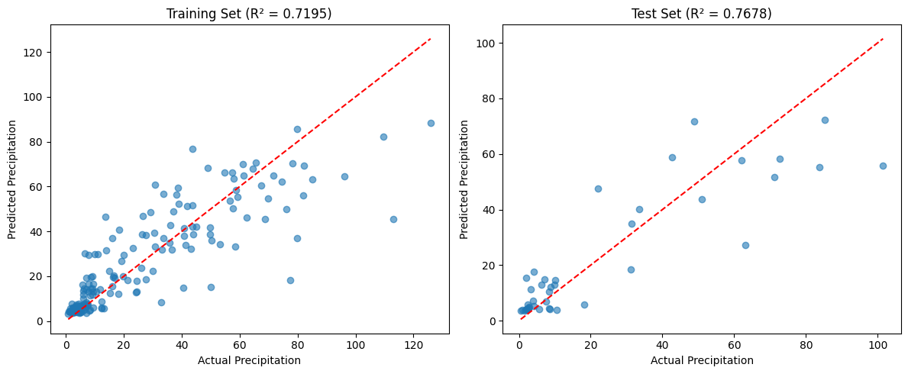

<!-- readme-visual-refresh:banner -->

<!-- /readme-visual-refresh:banner -->

# GeoTabPFN

基于TabPFN（Transformer-based Neural Network）的地理数据分析项目，用于预测和分析降水量（Precipitation）数据。

## 项目结构

```
GeoTabPFN/
├── data/                   # 数据目录
│   ├── machine_l.csv      # CSV格式数据文件
│   └── machine_l.xlsx     # Excel格式数据文件
├── model/                  # 模型目录
│   └── tabpfn-v2-regressor.ckpt  # TabPFN预训练模型检查点
├── code.ipynb             # 主要的分析和模型训练代码
├── README.md              # 项目说明文档
└── requirements.txt       # 项目依赖包列表
```

## 功能特性

- 使用TabPFN进行降水量预测
- 包含数据预处理和模型训练流程
- 提供模型性能评估（MSE、R²分数、相关系数）
- 使用SHAP进行特征重要性分析
- 可视化预测结果和模型解释

## 环境要求

- Python 3.9+
- 详细依赖请参见 requirements.txt

## 使用说明

1. 克隆项目到本地
2. 安装依赖：
   ```bash
   pip install -r requirements.txt
   ```
3. 运行Jupyter notebook：
   ```bash
   jupyter notebook code.ipynb
   ```

## 数据说明

输入特征包括：
- LWSC (Land Water Storage Change)
- Runoff
- E (Evaporation)
- Area

目标变量：
- P (Precipitation)

## 模型评估

模型使用以下指标进行评估：
- 均方误差 (MSE)
- 决定系数 (R²)
- 相关系数

## 可视化

项目提供多种可视化方式：
- 预测值vs实际值散点图
- SHAP特征重要性分析图
- SHAP瀑布图

## 注意事项

- 确保模型文件 `tabpfn-v2-regressor.ckpt` 位于正确的目录
- 数据文件需放置在 `data` 目录下

<!-- readme-visual-refresh:artwork-source -->
[Editable banner artwork · Excalidraw](assets/readme/banner.excalidraw)
<!-- /readme-visual-refresh:artwork-source -->


<!-- readme-visual-refresh:result -->
## Saved project output



Existing TabPFN precipitation fit: training and test scatter plots.

Historical project output, retained from the existing working files; it was not rerun for this documentation update.

Source: `code.ipynb [zero-based cell 0, output 1]`.
<!-- /readme-visual-refresh:result -->
